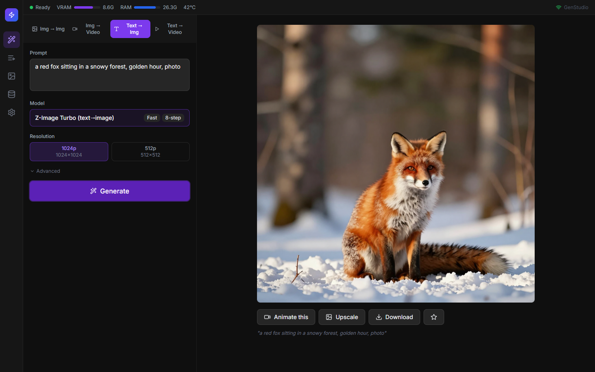
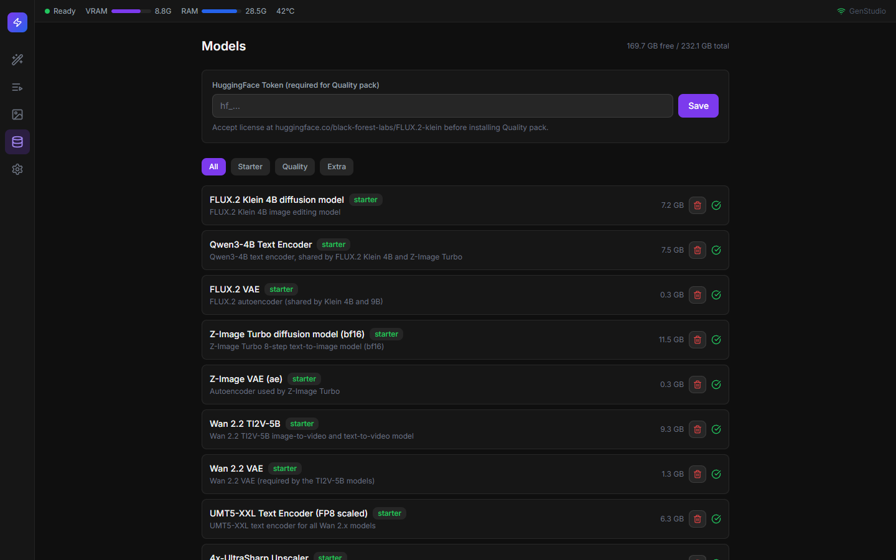
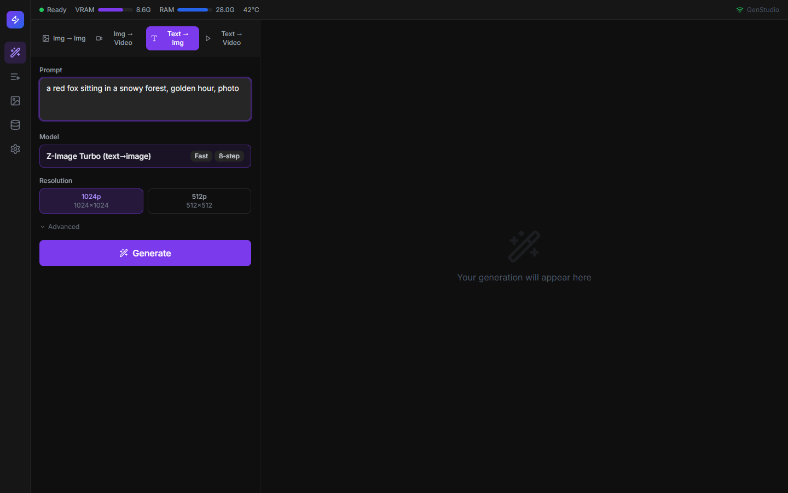
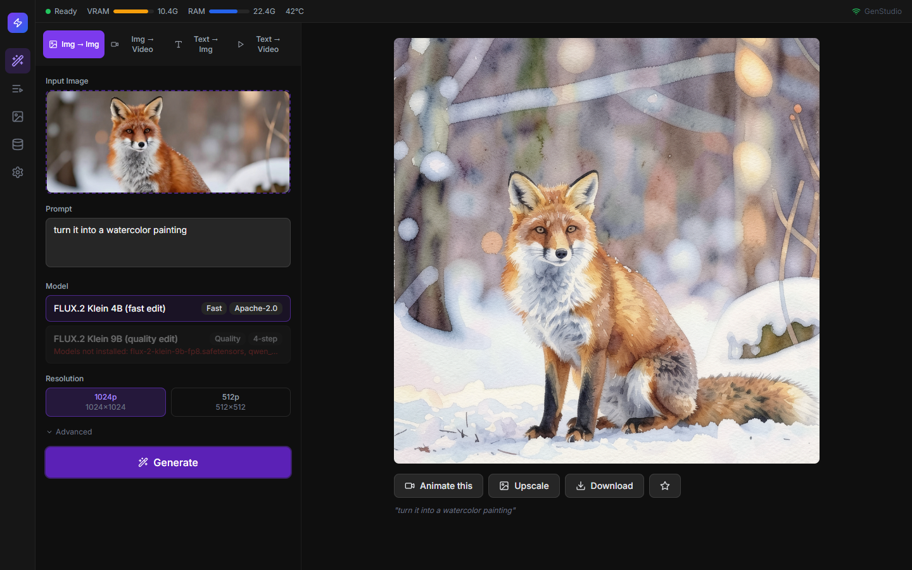
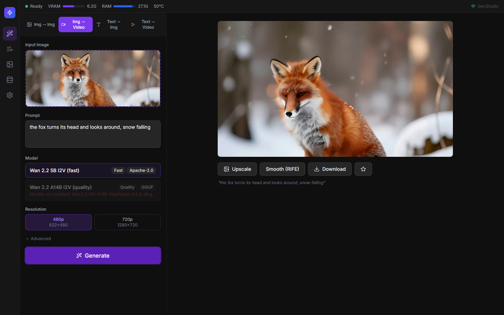
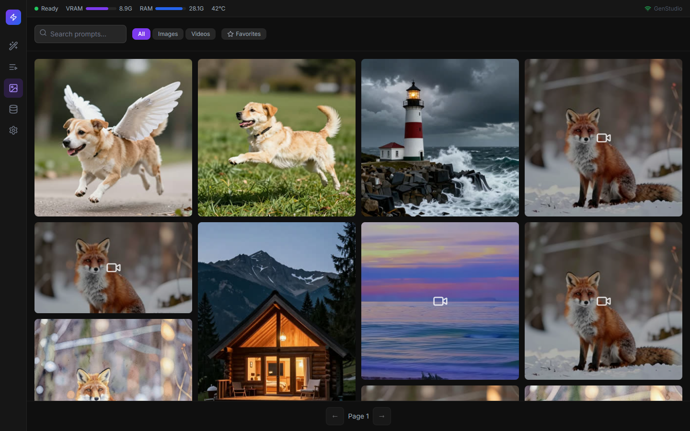
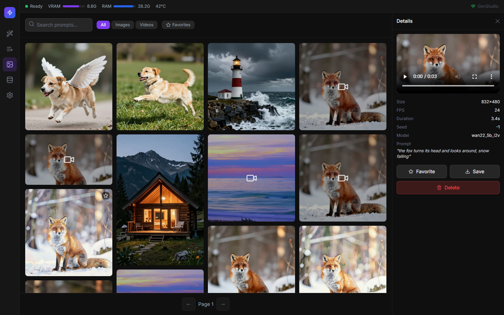
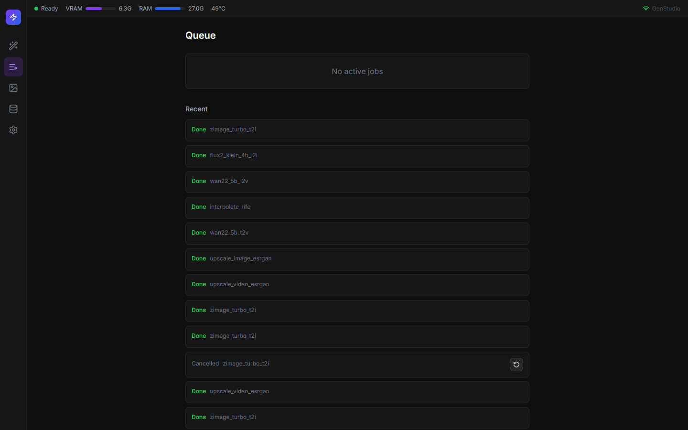
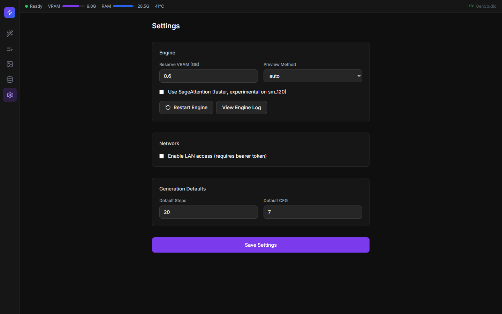

# GenStudio

**Make AI images and videos on your own PC. Free, private, no internet needed after setup.**

A local web app for generating images and videos on your own NVIDIA GPU. No cloud, no subscriptions, no uploads: everything runs on your machine.



GenStudio wraps [ComfyUI](https://github.com/comfyanonymous/ComfyUI) as a hidden engine and puts a simple interface in front of it, with a persistent job queue, a gallery, a model manager and one-click post-processing. It is tuned for 12 GB cards (developed and tested on an RTX 5070).

## Features

| Task | Model | Notes |
|------|-------|-------|
| Text to image | Z-Image Turbo | 8 steps, fast |
| Image to image (edit) | FLUX.2 klein 4B (fast) / 9B (quality) | Reference-image editing |
| Image to video | Wan 2.2 TI2V-5B (fast) / I2V A14B GGUF (quality) | |
| Text to video | Wan 2.2 TI2V-5B | |
| Upscale image / video | 4x-UltraSharp (ESRGAN) | |
| Smooth motion | RIFE 4.9 | Doubles the frame rate |

Plus:

- **Persistent queue.** Jobs live in SQLite, so they survive restarts. Reorder, cancel and retry from the UI.
- **Batch modes.** Seed variations, or one job per line of a prompt list.
- **Gallery.** Search by prompt, favorite, download, delete. Generation settings are embedded in PNG files.
- **LoRA support.** Drop `.safetensors` files into `models/loras`, rescan, and stack them with per-LoRA weights.
- **Model manager.** Install curated packs from HuggingFace with resumable downloads and disk-space checks.
- **12 GB friendly.** Quantized weights, one model family in VRAM at a time, tiled VAE decode, and automatic retry at a lower resolution on out-of-memory errors.
- **Live status.** Progress, ETA, VRAM, RAM and GPU temperature over WebSocket.
- **Optional LAN access** with a bearer token, so you can use it from a phone on the same network.
- **Data-driven pipelines.** A model is a `workflow_api.json` plus a `manifest.yaml`. Adding one needs no backend or UI code changes.

## Quick start for beginners

No coding needed. You only copy and paste a few commands. It takes about an hour, mostly waiting for downloads.

### Step 1. Check your PC

You need Windows 10/11 and an **NVIDIA graphics card** (8 GB of video memory or more; 12 GB is ideal) with about **60 GB of free disk space**. AMD and Intel graphics cards are not supported.

### Step 2. Install the helper programs (once)

Click the Start menu, type **PowerShell**, and open it. Paste this and press Enter. If Windows asks permission, click Yes:

```powershell
winget install Python.Python.3.12 astral-sh.uv OpenJS.NodeJS Git.Git Gyan.FFmpeg
```

When it finishes, **close PowerShell and open it again** so it notices the new programs.

### Step 3. Download and install GenStudio

```powershell
git clone https://github.com/shariorfarhan07/GenStudio.git
cd GenStudio
.\scripts\install.ps1
```

This takes 10 to 20 minutes. It sets up ComfyUI (the engine) with its own Python environment, PyTorch for your GPU, three ComfyUI add-ons (GGUF, frame interpolation, video helper), the backend and the web interface. It does not download any AI models; that is Step 5. If PowerShell says scripts are disabled, run `Set-ExecutionPolicy -Scope Process Bypass` and try the last command again.

### Step 4. Start it

```powershell
.\scripts\start.ps1
```

Wait about a minute, then open **http://localhost:8700** in your browser. Leave the PowerShell window open while you use the app; close it to stop GenStudio.

### Step 5. Download the AI models

Click the database icon in the left bar to open **Models**, then install the **Starter** pack (about 47 GB). Downloads can be paused and resumed. The green ticks show what is installed.



### Step 6. Make your first picture

1. Click the magic wand icon (**Create**) and choose the **Text → Img** tab.
2. Type what you want, for example `a red fox sitting in a snowy forest, golden hour, photo`.
3. Press **Generate**. The first picture takes about a minute while the model loads; later ones are much faster.



### Step 7. Edit a picture or make a video

- **Img → Img:** drop in a photo, say what to change (`turn it into a watercolor painting`), press Generate.
- **Img → Video:** drop in a picture and describe the movement (`the fox turns its head, snow falling`).
- **Text → Video:** describe a short clip and press Generate.





Under every result are one-click buttons: **Animate this** turns an image into a video, **Upscale** makes it sharper and larger, **Smooth (RIFE)** makes a video smoother, and **Download** saves it.

### Step 8. Find, download or delete your creations

Everything you make is saved in **Gallery**. Click an item to see its settings and to **Favorite**, **Save** (download) or **Delete** it.





### Step 9. Watch the queue

You can start several jobs at once. They wait their turn in **Queue**, where you can cancel or retry them.



### Next time

Open PowerShell, go to the GenStudio folder (`cd GenStudio`) and run `.\scripts\start.ps1` again. Your pictures are in the `outputs` folder.

### Something went wrong?

| What you see | What to do |
|--------------|------------|
| "Models not installed" in red under a model | Install the pack in **Models**. The message lists the missing files. |
| Status bar says **Stopped** | Wait a minute. If it stays, open **Settings > Restart Engine**. |
| "Out of memory" or a failed job | Pick the smaller resolution (for example 512p) or a shorter video, and try again. |
| First picture is slow | Normal. The model loads from disk the first time. |
| Browser shows nothing at localhost:8700 | Make sure the PowerShell window running `start.ps1` is still open. |

## Requirements in detail

- Windows 10 or 11
- NVIDIA GPU with 8 GB+ VRAM (12 GB recommended). RTX 50-series needs a recent driver for CUDA 13.
- 32 GB RAM recommended (16 GB works for the small models)
- 60 GB free disk for the Starter pack, about 100 GB with the Quality pack
- [Python 3.12](https://www.python.org/downloads/), [uv](https://docs.astral.sh/uv/), [Node.js 20+](https://nodejs.org/), [Git](https://git-scm.com/) and [ffmpeg](https://ffmpeg.org/) on your `PATH`

```powershell
winget install Python.Python.3.12 astral-sh.uv OpenJS.NodeJS Git.Git Gyan.FFmpeg
```

## Model packs

| Pack | Size | Contents | HuggingFace token |
|------|------|----------|-------------------|
| Starter | about 47 GB | FLUX.2 klein 4B, Z-Image Turbo, Wan 2.2 5B, 4x-UltraSharp, RIFE 4.9 | Not needed |
| Quality | about 39 GB | FLUX.2 klein 9B (FP8), Wan 2.2 A14B (GGUF Q4_K_M, high and low noise), LightX2V LoRAs | Needed for FLUX.2 9B |
| Extra | under 1 GB | Real-ESRGAN anime upscaler | Not needed |

For gated models, accept the license on the model's HuggingFace page, then paste a read token in **Models > HuggingFace Token**.

Weights are not part of this repository and keep their own licenses (see [Licenses](#licenses)).

## Using it

- **Create.** Pick a task tab, drop in an image if needed, write a prompt, choose a model and resolution tier, and press Generate. Results appear on the right with one-click **Animate**, **Upscale** and **Smooth motion** actions.
- **Queue.** Running and pending jobs, with reorder, cancel and retry.
- **Gallery.** Browse results. Click an item for its settings and the favorite, download and delete buttons.
- **Models.** Install packs, manage the LoRA library, set the HuggingFace token.
- **Settings.** Engine options, LAN access and token, defaults, engine log.



### LAN access

Turn on **LAN access** in Settings and generate a token. Other devices must send it as `Authorization: Bearer <token>` or `?token=<token>`. Requests from the same PC never need a token. Restart the app after changing this setting.

## Development

```powershell
.\scripts\start_dev.ps1          # backend with auto-reload on :8700, Vite on :5173
```

```powershell
cd backend
.\.venv\Scripts\python.exe -m pytest tests -q
```

```powershell
cd frontend
npm run build                    # type-check and production build
```

### Project layout

```
backend/
  app/
    api/            REST routes
    engine/         ComfyUI process manager and client
    jobs/           queue, scheduler, event bus, database models
    pipelines/      registry, graph patcher, templates/<id>/
    models_mgr/     model catalog and downloader
    media/          ffmpeg helpers, output store
    gpu/            GPU and system monitor
  tests/
frontend/           React, Vite, TypeScript, Tailwind
engine/             ComfyUI and its venv (created by install.ps1)
models/             weights shared with ComfyUI
scripts/            install, start, update, smoke
data/ outputs/ logs/  runtime state (not committed)
```

### How it fits together

```
Browser  ->  FastAPI :8700  ->  ComfyUI :8188 (localhost only)
                |-- SQLite job queue and gallery
                |-- model downloader
                |-- GPU monitor (NVML)
                `-- WebSocket event stream
```

### Adding a pipeline

1. In ComfyUI, build the workflow and export it with **Save (API Format)**.
2. Create `backend/app/pipelines/templates/<id>/` with that file as `workflow_api.json`.
3. Add a `manifest.yaml` that names the task, label and family, and maps each UI parameter to a node input. Copy an existing manifest as a starting point.
4. Add any new model files to `backend/app/models_mgr/catalog.yaml`.

The pipeline shows up in the UI on the next start. Model files and node classes are checked automatically, and pipelines with missing pieces are greyed out with the reason shown.

## Updating

```powershell
.\scripts\update.ps1
```

Pulls ComfyUI and the custom nodes, runs the smoke checks, and rolls back if they fail.

## Status

Verified end to end on an RTX 5070 (12 GB): text to image, image edit, image to video, text to video, image and video upscale, RIFE interpolation, batch variations and cancel.

Not yet verified: LoRA stacking and the Quality pack pipelines (FLUX.2 9B, Wan 2.2 A14B). The A14B workflow does not apply the LightX2V speed-up LoRAs yet, so it runs the full step count.

## Licenses

GenStudio's own code is not yet licensed; add a `LICENSE` file before publishing.

Model weights are downloaded from their original sources and keep their licenses:

- Apache-2.0: FLUX.2 klein 4B, Z-Image Turbo, Wan 2.2, Qwen3 text encoders, LightX2V
- FLUX.2 klein 9B: Black Forest Labs non-commercial license
- 4x-UltraSharp: CC BY-NC-SA 4.0 (non-commercial)
- RIFE: MIT. Real-ESRGAN: BSD-3-Clause

Check each model's license before any commercial use.

## Acknowledgements

[ComfyUI](https://github.com/comfyanonymous/ComfyUI), [ComfyUI-GGUF](https://github.com/city96/ComfyUI-GGUF), [ComfyUI-Frame-Interpolation](https://github.com/Fannovel16/ComfyUI-Frame-Interpolation), [ComfyUI-VideoHelperSuite](https://github.com/Kosinkadink/ComfyUI-VideoHelperSuite), Black Forest Labs, the Wan team, Tongyi-MAI (Z-Image), and the teams behind RIFE and Real-ESRGAN.
